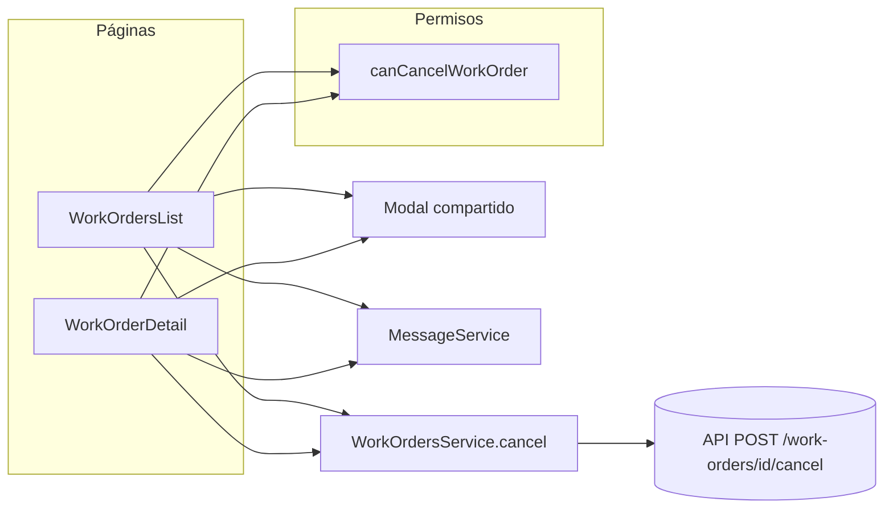

# 019 — Diseño: Cancelar orden

Sigue el patrón de **Liberar** (spec 013d): política pura en `work-order.permissions.ts`, método en
`WorkOrdersService` con traducción de errores de transición, y modal de confirmación en la página. La
lógica de negocio queda en las páginas; el `Modal` compartido solo emite `confirmed`.

## Decisiones técnicas

- **D1 — Sin componente nuevo.** Se reutilizan `Button` (`variant="danger"`), `Modal`, `MessageService`.
  Alternativa descartada: un `CancelOrderButton` compartido; ambas pantallas lo necesitarían con
  lógica de negocio adentro, y `CLAUDE.md` la prohíbe en `shared/`.
- **D2 — Doble envío (REQ-5.6, enmendado).** El `Modal` se cierra solo al confirmar (`confirm()` emite
  y cierra), así que no hay botón de confirmación que deshabilitar durante la llamada. REQ-5.6 se
  enmendó: se deshabilita el botón "Cancelar orden" de la fila o del detalle (`isBusy` / `cancelling`)
  y `confirmCancel()` ignora una segunda llamada. No se modifica el `Modal` compartido.
- **D3 — 404 y conexión.** `cancel()` hace un `catchError` propio: primero `404` →
  `WorkOrderLoadError('not-found')` (tipo ya existente) y, si no es 404, `translateTransitionError`
  (409). No reutiliza `translateWriteError`, que mapea códigos de referencias y validación que no
  aplican acá. Cualquier otro error no tipado (incluida la falla de conexión) cae en un toast genérico
  "No se pudo cancelar la orden. Verificá tu conexión e intentá nuevamente."
- **D4 — Refresco del detalle.** `WorkOrderLoader.workOrder` ya es un `signal` público: el detalle
  hace `loader.workOrder.set(ordenActualizada)` en éxito y `loader.retry()` ante un
  `WorkOrderStateError`. No se toca el loader.
- **D5 — Mensajes y textos en un solo lugar por pantalla.** Texto del botón "Cancelar orden"; modal con
  `confirmText="Cancelar orden"` y `cancelText="Volver"` (evita dos botones "Cancelar" ambiguos).

## Interfaces

### Política (`features/work-orders/models/work-order.permissions.ts`)

```ts
const CANCEL_ROLES: readonly UserRole[] = ['administrador', 'team-leader-mantenimiento'];

// Cancelar una orden pendiente: administrador y team leader. Una orden en progreso se libera primero.
export function canCancelWorkOrder(
  user: AuthUser | null,
  order: Pick<WorkOrder, 'status'>,
): boolean;
```

### Servicio (`features/work-orders/data-access/work-order.service.ts`)

```ts
// POST {apiUrl}/{id}/cancel, sin cuerpo. Devuelve la orden actualizada.
// 404                        -> WorkOrderLoadError('not-found', ...)     (catchError propio, primero)
// 409 WORK_ORDER_NOT_PENDING -> WorkOrderStateError('not-pending', null, details.status)
//                               (vía translateTransitionError)
// resto                      -> el error original (el 403 lo avisa el interceptor)
cancel(id: string): Observable<WorkOrder>;
```

### Lista (`pages/work-orders-list/work-orders-list.ts` y `.html`)

```ts
readonly cancelModalOpen = signal(false);
readonly workOrderToCancel = signal<WorkOrder | null>(null);
readonly cancelMessage = computed<string>();   // nombra la orden: `La orden "<título>" pasa a Cancelada...`

canCancel(order: WorkOrder): boolean;          // canCancelWorkOrder(currentUser, order)
openCancelModal(order: WorkOrder): void;       // REQ-2.3 / REQ-6.1
confirmCancel(): void;                         // REQ-2.4, 2.6, 2.7, 5.x
```

Plantilla: dentro de las acciones de la fila, `@if (canCancel(workOrder))` con
`<app-button size="sm" variant="danger" [ariaLabel]="'Cancelar orden ' + workOrder.title" [disabled]="isBusy(workOrder.id)" (clicked)="openCancelModal(workOrder)">Cancelar orden</app-button>`,
y un `<app-modal [(isOpen)]="cancelModalOpen" title="Cancelar orden de trabajo" [message]="cancelMessage()" confirmText="Cancelar orden" cancelText="Volver" (confirmed)="confirmCancel()" />`.

### Detalle (`pages/work-order-detail/work-order-detail.ts` y `.html`)

```ts
// inyecta AuthService, MessageService, WorkOrdersService, DestroyRef
readonly canCancel = computed<boolean>();      // canCancelWorkOrder(currentUser, workOrderDetail()) y la orden != null
readonly cancelModalOpen = signal(false);
readonly cancelling = signal(false);
readonly cancelMessage = computed<string>();

openCancelModal(): void;                       // REQ-2.3 / REQ-6.1
confirmCancel(): void;                         // REQ-2.4, 2.6, 3.3, 5.x
```

Plantilla: el botón y el modal van dentro de la rama `@else if (workOrderDetail(); as ...)`, por lo
que no existen mientras carga ni si falló la carga (REQ-3.4).

## Comportamiento de `confirmCancel()` (ambas páginas)

1. Sin orden seleccionada → no hace nada.
2. Si `!canCancel(order)` → toast de advertencia "No tiene permiso para cancelar órdenes." (REQ-6.1).
3. Si está ocupada (`isBusy` / `cancelling`) → ignora (REQ-5.6).
4. Marca ocupada y llama a `workOrdersService.cancel(order.id)` con `takeUntilDestroyed` y `finalize`.
5. Éxito → toast "Orden cancelada." (REQ-2.6). Lista: `loadWorkOrders()` (REQ-2.7). Detalle:
   `loader.workOrder.set(updated)` (REQ-3.3).
6. `WorkOrderStateError` → toast de advertencia con `error.message` y título "No se puede cancelar";
   refresca (lista: `loadWorkOrders()`, detalle: `loader.retry()`) (REQ-5.2).
7. `WorkOrderLoadError` kind `not-found` → lista: toast de advertencia "La orden ya no existe." y
   `loadWorkOrders()`; detalle: `loader.workOrder.set(null)` y `loader.error.set('not-found')`, que muestra la alerta
   existente (REQ-5.3). Se limpia la orden para que `canCancel` no quede en `true` por debajo de la
   alerta. El botón "Reintentar" de esa alerta vuelve a pedir la orden y sigue mostrando "no
   encontrada": se acepta, es el comportamiento actual de la página.
8. `errorStatus(error) === 403` → no hace nada más (REQ-5.4).
9. Cualquier otro error → toast de error genérico (D3, REQ-5.5).

## Diagramas



```mermaid
sequenceDiagram
  actor U as Admin / Team leader
  participant Pg as Página (lista o detalle)
  participant Mo as Modal
  participant Sv as WorkOrdersService
  participant Api as API
  U->>Pg: pulsa "Cancelar orden"
  Pg->>Pg: canCancel(order)?
  Pg->>Mo: abre confirmación (sin llamar a la API)
  U->>Mo: confirma
  Mo-->>Pg: confirmed
  Pg->>Sv: cancel(id)
  Sv->>Api: POST /work-orders/{id}/cancel
  alt 200
    Api-->>Sv: orden cancelled
    Sv-->>Pg: WorkOrder
    Pg->>U: toast "Orden cancelada." + estado actualizado
  else 409 WORK_ORDER_NOT_PENDING
    Api-->>Sv: error
    Sv-->>Pg: WorkOrderStateError
    Pg->>U: toast con el motivo + refresco
  else 404
    Sv-->>Pg: WorkOrderLoadError not-found
    Pg->>U: aviso de orden inexistente
  else 403
    Note over Pg,U: el interceptor ya avisó; la página no duplica
  else sin conexión u otro error
    Pg->>U: toast de error genérico
  end
```

## Trazabilidad

| Requisito           | Qué lo cubre                                                |
| ------------------- | ----------------------------------------------------------- |
| REQ-1.1 a 1.5       | `canCancelWorkOrder` + `CANCEL_ROLES`                       |
| REQ-2.1, 2.2        | `canCancel` + `@if` en la fila de la lista                  |
| REQ-2.3, 2.5        | `openCancelModal` + `Modal` (`cancelled` no llama a la API) |
| REQ-2.4, 2.6        | `confirmCancel` (pasos 4 y 5)                               |
| REQ-2.7             | `loadWorkOrders()` en el éxito de la lista                  |
| REQ-3.1, 3.2        | `canCancel` computed + `@if` en el detalle                  |
| REQ-3.3             | `loader.workOrder.set(updated)`                             |
| REQ-3.4             | botón y modal dentro de la rama con la orden cargada        |
| REQ-4.1             | `WorkOrdersService.cancel`                                  |
| REQ-5.1             | `cancel`: 409 vía `translateTransitionError`                |
| REQ-5.2             | paso 6 de `confirmCancel`                                   |
| REQ-5.3             | `cancel` traduce 404 + paso 7                               |
| REQ-5.4             | paso 8                                                      |
| REQ-5.5             | paso 9 + D3                                                 |
| REQ-5.6 (enmendado) | D2: botón deshabilitado + guard `isBusy` / `cancelling`     |
| REQ-6.1             | paso 2 y `openCancelModal`                                  |

## Estrategia de testing

Los nombres de test incluyen el id del criterio (`REQ-n.m`).

| Requisitos                            | Archivo de test                  | Qué se prueba                                                                                                                        |
| ------------------------------------- | -------------------------------- | ------------------------------------------------------------------------------------------------------------------------------------ |
| REQ-1.1 a 1.5                         | `work-order.permissions.spec.ts` | `canCancelWorkOrder` por rol (4 roles + `null`) y por estado (4 estados)                                                             |
| REQ-4.1, 5.1, 5.3                     | `work-order.service.spec.ts`     | `HttpTestingController`: `POST .../cancel` sin cuerpo, 200, 409 `WORK_ORDER_NOT_PENDING`, 404                                        |
| REQ-2.1 a 2.7, 5.2 a 5.6, 6.1         | `work-orders-list.spec.ts`       | botón visible/oculto por rol y estado, modal abre/descarta, llamada al confirmar, toast y recarga, errores, doble envío, sin permiso |
| REQ-3.1 a 3.4 y errores en el detalle | `work-order-detail.spec.ts`      | botón por rol y estado, ausente mientras carga o con error, badge actualizado, errores 409/404/403/otro                              |
