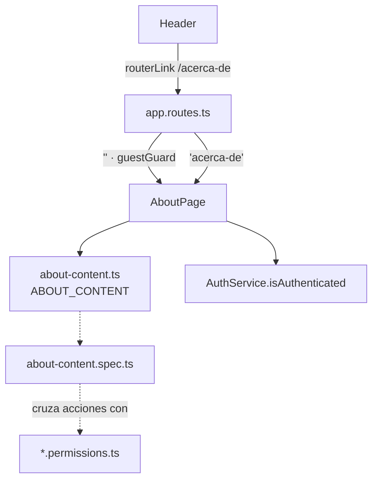
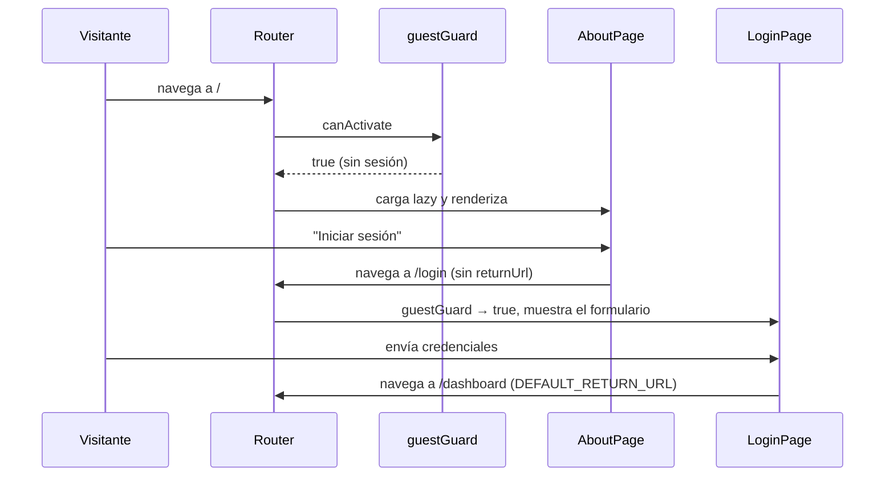

# Diseño: Portada pública y página "Acerca de"

## Resumen y decisiones clave

Una sola página standalone, `AboutPage`, en una feature nueva `features/about/`, atendida por dos
rutas de `app.routes.ts`: `/` (con el guard existente `guestGuard`, que manda a `/dashboard` a
quien ya tiene sesión) y `/acerca-de` (sin guard). El contenido es una constante tipada
(`about-content.ts`) y la página solo lo pinta, así un test puede cruzar las acciones de cada
tarjeta de rol contra los archivos de permisos. El enlace "Acerca de" se agrega al `Header`.
No hay HTTP, servicios nuevos ni cambios en el flujo de sesión.

Decisiones principales:

1. **Reutilizar `guestGuard` en `/`** en vez de crear un guard nuevo (ver "Decisiones descartadas").
2. **El contenido vive en datos, no en el template**, para poder verificarlo contra los permisos
   (REQ-4.6 / NFR-5).

## Arquitectura



## Componentes e interfaces

### Rutas (`app/app.routes.ts`)

- **Responsabilidad:** reemplazar `'' → redirectTo 'dashboard'` por dos rutas hacia `AboutPage`.
- **Cubre:** REQ-1.1, REQ-1.2, REQ-2.1, REQ-2.2, REQ-7.1, REQ-7.2, REQ-9.1–9.3, REQ-10.1, NFR-3
- **Desviación aceptada en REQ-2.1:** con sesión y `/?returnUrl=/work-orders`, `guestGuard`
  redirige a `/work-orders` y no a `/dashboard`. El valor pasa por `sanitizeReturnUrl`, así que
  solo puede ser una ruta interna; se fija con un test.
- **Interfaz:**
  ```ts
  {
    path: '',
    pathMatch: 'full',
    canActivate: [guestGuard],   // con sesión → /dashboard (returnUrl saneado, por defecto /dashboard)
    title: 'Acerca de | Angular Enterprise Lab',
    loadComponent: () => import('./features/about/pages/about-page/about-page').then((m) => m.AboutPage),
  },
  {
    path: 'acerca-de',
    title: 'Acerca de | Angular Enterprise Lab',
    loadComponent: () => import('./features/about/pages/about-page/about-page').then((m) => m.AboutPage),
  },
  ```
  Ambas quedan **fuera** del grupo protegido (`canActivateChild: [authGuard]`) y antes del
  comodín `**`. El `title` es el mismo literal; el implementador lo define como constante
  local para no duplicarlo.

### `AboutPage` (`features/about/pages/about-page/`)

- **Responsabilidad:** pintar `ABOUT_CONTENT` y decidir el botón principal según la sesión.
- **Cubre:** REQ-1.3, REQ-3.1–3.4, REQ-4.1, REQ-5.1–5.2, REQ-6.1–6.6, REQ-7.3–7.4, NFR-1, NFR-2
- **Interfaz:**
  ```ts
  @Component({ selector: 'app-about-page', imports: [RouterLink], … })
  export class AboutPage {
    private readonly authService = inject(AuthService);
    readonly isAuthenticated = this.authService.isAuthenticated;
    readonly content = ABOUT_CONTENT;
  }
  ```
- **Estructura del template** (todo dentro del `<main>` que ya pone el shell):
  1. `<section>` hero: `h1` "Centro de Gestión de Mantenimiento", frase, y el botón principal.
  2. `<section>` "Cómo avanza una orden": `<ol>` con los 5 pasos.
  3. `<section>` "Quién usa la aplicación": 4 tarjetas de rol (`h3` + `<ul>` de acciones).
  4. `<section>` "Qué puede hacer": 4 tarjetas de área (`h3` + descripción).
  5. `<section>` de cierre con el segundo botón.
     Cada sección tiene un `h2`; los títulos de tarjeta son `h3`: sin saltos de nivel.
- **Botón principal / final:** enlaces con las clases globales de botón, igual que la página 404
  (`<a routerLink="/login" class="btn btn--primary">`). Sin sesión: "Iniciar sesión" →
  `/login` (sin `queryParams`, así `returnUrl` queda vacío y el destino es `/dashboard`).
  Con sesión: "Ir al tablero" → `/dashboard`. Se usa `<a routerLink>` y no `<app-button>`
  porque `Button` emite un evento y no navega.
- **Estilos:** `about-page.scss`; reutiliza `.card`, `.card__title` y `.card__description`.
  Mobile primero: una columna; grilla de dos columnas desde `$breakpoint-md` (NFR-2).
  Sin `img`, `svg` ni `picture` (REQ-3.4).

### Contenido (`features/about/models/about-content.ts`)

- **Responsabilidad:** única fuente de los textos y de las acciones por rol.
- **Cubre:** REQ-3.2–3.3, REQ-4.2–4.6, REQ-5, NFR-4, NFR-5
- **Interfaz:**
  ```ts
  export type RoleActionId =
    | 'create-preventive-corrective'
    | 'create-urgent'
    | 'edit-orders'
    | 'delete-orders'
    | 'release-orders'
    | 'cancel-orders'
    | 'take-orders'
    | 'close-orders'
    | 'manage-machines'
    | 'manage-technicians'
    | 'manage-teams';

  export interface RoleCard {
    role: UserRole; // 'administrador' | 'team-leader-mantenimiento' | …
    title: string; // REQ-4.1
    actions: readonly { id: RoleActionId; label: string }[];
  }
  export interface AreaCard {
    title: string;
    description: string;
  }
  export interface OrderStep {
    title: string;
    description: string;
  }

  export interface AboutContent {
    heroTagline: string;
    steps: readonly OrderStep[]; // 5, en orden: crear, tomar, cerrar, liberar, cancelar
    roles: readonly RoleCard[]; // 4
    areas: readonly AreaCard[]; // 4
  }
  export const ABOUT_CONTENT: AboutContent;
  ```

### Textos (redacción propuesta, a aprobar)

Tono de producto para planta, español neutro (impersonal o "usted"), sin los términos de NFR-4.

- **Frase del hero:** "Gestión de órdenes de mantenimiento de la planta: quién pide un trabajo,
  quién lo toma y cómo se cierra."
- **Pasos de una orden:**
  1. **Crear:** "Producción o el team leader registran la falla indicando la máquina y la parte afectadas."
  2. **Tomar:** "Un técnico habilitado toma la orden pendiente y queda como su responsable."
  3. **Cerrar:** "El técnico la cierra como completada o cancelada, con un comentario obligatorio."
  4. **Liberar:** "Si la orden está en curso y el técnico no puede seguir, se libera y vuelve a pendiente."
  5. **Cancelar:** "Una orden pendiente que ya no hace falta la cancela el administrador o el team leader."
- **Roles** (acciones literales de REQ-4):
  - _Administrador:_ Editar órdenes · Eliminar órdenes · Liberar órdenes · Cancelar órdenes ·
    Gestionar máquinas · Gestionar técnicos.
  - _Team Leader de Mantenimiento:_ Crear órdenes preventivas y correctivas · Editar órdenes ·
    Liberar órdenes · Cancelar órdenes · Gestionar máquinas · Gestionar técnicos · Gestionar equipos.
  - _Personal de Producción:_ Crear órdenes de pronto intervención.
  - _Técnico:_ Tomar órdenes según su tipo de equipo · Cerrar las órdenes que tomó.
- **Áreas:**
  - _Órdenes de trabajo:_ "Registro, búsqueda y seguimiento de las órdenes por estado y prioridad."
  - _Máquinas y partes:_ "Cada máquina con el árbol de sus partes, para ubicar con precisión dónde ocurre la falla."
  - _Técnicos y equipos:_ "Alta de técnicos con su legajo, especialidad y tipo de equipo, y armado de equipos de trabajo."
  - _Tablero de turno:_ "Resumen del turno: órdenes pendientes y en curso, las suyas en curso y las cerradas hoy."

Las afirmaciones de los pasos y áreas (comentario obligatorio al cerrar, legajo, "cerradas hoy",
estado y prioridad) se confirman una a una contra el código en la tarea de implementación; si
alguna no se sostiene, se acota el texto.

> **Enmienda a REQ-4.5 (ya aplicada en `requirements.md`, con rastro).** El requisito decía que
> el técnico toma y cierra órdenes "ambas según su especialidad y tipo de equipo". En el código
> _tomar_ depende solo del tipo de equipo (`canTakeWorkOrder`) y _cerrar_ exige ser el dueño de
> la orden en curso (`canResolveWorkOrder`). Los textos y el test de NFR-5 usan esa versión. Queda
> sujeta a tu aprobación junto con este diseño.

### `Header` (`app/layout/header/`)

- **Responsabilidad:** mostrar siempre el enlace "Acerca de".
- **Cubre:** REQ-8.1–8.3, NFR-2 (REQ-7.3 y 7.4 se cumplen porque el shell no se modifica)
- **Impacto en tests:** como `Header` pasa a usar `RouterLink`, `header.spec.ts` necesita
  `provideRouter([])`. Además, el botón "Volver al inicio" del 404 (`routerLink="/"`) ahora
  lleva a la portada si no hay sesión (antes terminaba en el login); es coherente con REQ-1.1 y
  se cubre en el test de `/`.
- **Cambio:**
  ```html
  <p class="header__title">Centro de Gestión de Mantenimiento</p>
  <a class="header__link" routerLink="/acerca-de" routerLinkActive ariaCurrentWhenActive="page"
    >Acerca de</a
  >
  @if (userName() !== null) { … sesión (sin cambios) … }
  ```
  `Header` suma `RouterLink` y `RouterLinkActive` a `imports`. El título sigue siendo un `<p>`
  sin enlace.
- **Estilos** (en `styles/layout/_shell.scss`, donde ya viven los del header): `.header__link`
  en blanco, `flex-shrink: 0`, subrayado en hover, `outline-color` de foco igual que
  `.header .btn:focus-visible`. Por debajo de `md`, `.header__user` baja de `7rem` a `4.5rem`
  para que el título (que ya se trunca) siga cediendo espacio antes de empujar el botón de
  cerrar sesión.

### Navegación (`layout/nav-items.ts`, `Sidebar`, `BottomNav`)

- **Cubre:** REQ-8.4, REQ-9.4
- **Sin cambios.** "Acerca de" no es un `NavItem`.

## Modelo de datos

Sin entidades ni persistencia. El único tipo nuevo es `AboutContent` (arriba), constante en
tiempo de compilación.

## Flujos principales



Con sesión, en el paso del guard: `G-->>R: UrlTree('/dashboard')` y `AboutPage` no se crea.

## Manejo de errores

- No hay llamadas a la API, así que no hay errores de red ni de permisos propios de la página.
- Si la sesión se limpia mientras se mira `/acerca-de` (cierre de sesión o un `401` que la
  invalida): la página no depende de ella y el botón cambia a "Iniciar sesión" porque
  `isAuthenticated` es una señal.
- El chunk lazy falla al cargar (red): lo cubre el manejo global de navegación existente; no se
  agrega nada.
- `/?returnUrl=…` con sesión: `guestGuard` saneaba el valor (`sanitizeReturnUrl`); un valor
  externo o inválido cae en `/dashboard`.

## Estrategia de testing

| Test                                                                                                                                                                                  | Criterios                     |
| ------------------------------------------------------------------------------------------------------------------------------------------------------------------------------------- | ----------------------------- |
| `app.routes.spec.ts` (se actualiza y amplía): sin sesión, `/` renderiza `AboutPage` y la URL sigue siendo `/`                                                                         | REQ-1.1, REQ-1.2              |
| Ídem: con sesión, `/` termina en `/dashboard`; con `/?returnUrl=/work-orders` termina en `/work-orders` (desviación aceptada) y con un `returnUrl` externo, en `/dashboard`           | REQ-2.1                       |
| Ídem: sin sesión, "Volver al inicio" del 404 lleva a la portada                                                                                                                       | REQ-1.1                       |
| Ídem: sin sesión, `/dashboard` va a `/login?returnUrl=%2Fdashboard`                                                                                                                   | REQ-2.2                       |
| Ídem: `/acerca-de` con y sin sesión no redirige                                                                                                                                       | REQ-7.1, REQ-7.2              |
| Ídem: sin sesión, `/work-orders`, `/maintenance`, `/machines` van a login; con sesión `/login` redirige; URL inexistente → 404                                                        | REQ-9.1, REQ-9.2, REQ-9.3     |
| Ídem: el título del documento es `Acerca de \| Angular Enterprise Lab` en `/` y en `/acerca-de`                                                                                       | REQ-10.1                      |
| `about-page.spec.ts`: no usa `HttpTestingController` y `httpMock.verify()` pasa; sin `img`/`svg`/`picture`                                                                            | REQ-1.3, REQ-3.4              |
| `about-page.spec.ts`: un `h1`, frase con "órdenes de mantenimiento", 5 pasos en orden                                                                                                 | REQ-3.1, REQ-3.2, REQ-3.3     |
| `about-page.spec.ts`: 4 tarjetas de rol con sus títulos y acciones literales; 4 tarjetas de área con título y descripción                                                             | REQ-4.1–4.5, REQ-5.1, REQ-5.2 |
| `about-page.spec.ts`: sin sesión, dos "Iniciar sesión" con `href` a `/login` sin `returnUrl`; con sesión, "Ir al tablero" a `/dashboard`                                              | REQ-6.1, 6.2, 6.3, 6.5, 6.6   |
| `app.routes.spec.ts`: login desde la página lleva a `/dashboard`                                                                                                                      | REQ-6.4                       |
| `app-shell.spec.ts` (o `app.routes.spec.ts`): en `/acerca-de` con sesión siguen el sidebar y la barra inferior                                                                        | REQ-7.3, REQ-7.4              |
| `header.spec.ts`: enlace "Acerca de" con y sin sesión (también con la URL en `/login` y 404), al lado del nombre y del botón; navega sin cerrar sesión                                | REQ-8.1, 8.2, 8.3             |
| `sidebar.spec.ts` / `bottom-nav.spec.ts` / `nav-items.spec.ts`: sin "Acerca de"; ítems por rol sin cambios                                                                            | REQ-8.4, REQ-9.4              |
| `about-content.spec.ts`: cada acción de cada tarjeta se cumple según `work-order.permissions.ts`, `maintenance.permissions.ts` y `machines.permissions.ts` para un usuario de ese rol | REQ-4.6, NFR-5                |
| `about-content.spec.ts`: ningún texto contiene "Angular", "API", "JWT", "token", "repositorio" ni "Spring"                                                                            | NFR-4                         |
| `pnpm lint` (reglas de accesibilidad de templates)                                                                                                                                    | NFR-1                         |
| `pnpm build` (chunk lazy separado del bundle inicial)                                                                                                                                 | NFR-3                         |
| Manual a 320 y 360 px: sin scroll horizontal, tarjetas en una columna, header legible con y sin sesión; desde 768 px, dos columnas                                                    | NFR-2                         |

El mapeo de `RoleActionId` a predicado en `about-content.spec.ts`: `edit-orders` →
`canEditWorkOrder`; `delete-orders` → `canDeleteWorkOrder`; `release-orders` →
`canReleaseWorkOrder(user, { status: 'in-progress' })`; `cancel-orders` →
`canCancelWorkOrder(user, { status: 'pending' })`; `create-*` → `creatableTypes`;
`take-orders` y `close-orders` → `canTakeWorkOrder` y `canResolveWorkOrder` con un técnico de
prueba habilitado y dueño; `manage-machines` → `canManageMachines`; `manage-technicians` →
`canViewTechnicians`; `manage-teams` → `canManageTeams`.

## Decisiones descartadas

- **Guard nuevo (`rootGuard`) para `/`:** `guestGuard` ya hace exactamente eso (con sesión →
  `returnUrl` saneado o `/dashboard`). La única diferencia es que `/?returnUrl=/x` con sesión
  iría a `/x` en vez de `/dashboard`, inocuo porque el valor está saneado. No justifica un guard
  más.
- **Enlace "Acerca de" en el sidebar y la barra inferior:** la barra ya tiene hasta cinco ítems
  y el enlace debe verse también sin sesión, cuando esas navegaciones no existen.
- **Redirigir a `/dashboard` también en `/acerca-de`:** anularía su función de página de
  consulta para quien ya tiene sesión (REQ-7.2).
- **Textos escritos a mano en el template:** impiden verificarlos contra los permisos
  (REQ-4.6) y duplican literales entre template y tests.
- **Usar `<app-button>` para los accesos:** emite un evento, no navega; haría falta inyectar el
  `Router` en la página solo para eso. Un `<a routerLink class="btn">` es lo que ya usa el 404.
- **Un `about.routes.ts` con `loadChildren`:** hay una sola página; el patrón del repo para eso es
  `loadComponent` en `app.routes.ts` (como `dashboard`).
- **Nombre de feature `home`:** choca con el ítem "Inicio" de la navegación, que apunta al
  dashboard.

## Trazabilidad

| Requisito | Cubierto por                                                                  |
| --------- | ----------------------------------------------------------------------------- |
| REQ-1     | Ruta `''` + `AboutPage` (sin HTTP)                                            |
| REQ-2     | `guestGuard` en la ruta `''`; `authGuard` del grupo protegido (sin cambios)   |
| REQ-3     | `AboutPage` + `ABOUT_CONTENT` (`heroTagline`, `steps`)                        |
| REQ-4     | `ABOUT_CONTENT.roles` + `about-content.spec.ts`                               |
| REQ-5     | `ABOUT_CONTENT.areas`                                                         |
| REQ-6     | Enlaces `routerLink` de `AboutPage`; destino por defecto de login sin cambios |
| REQ-7     | Ruta `acerca-de` fuera del grupo protegido; el shell no se modifica           |
| REQ-8     | `Header` (`header__link`); `nav-items.ts` sin cambios                         |
| REQ-9     | Rutas protegidas, `guestGuard` de `/login` y comodín `**` sin cambios         |
| REQ-10    | `title` en ambas rutas                                                        |
| NFR-1     | Jerarquía h1/h2/h3 del template + lint                                        |
| NFR-2     | `about-page.scss` mobile primero + ajuste de `.header__user`                  |
| NFR-3     | `loadComponent()`                                                             |
| NFR-4     | Textos de `ABOUT_CONTENT` + test de términos prohibidos                       |
| NFR-5     | `about-content.spec.ts`                                                       |
| NFR-6     | Tests nuevos y actualizados + `lint`, `test`, `build`                         |

Decisiones técnicas sin requisito directo: el ajuste de `.header__user` por debajo de `md`
(evita que el enlace nuevo empuje el botón de cerrar sesión fuera de pantalla a 320 px) y
`ariaCurrentWhenActive="page"` en el enlace (indica la página actual a lectores de pantalla).

---

**Estado:** Aprobado
