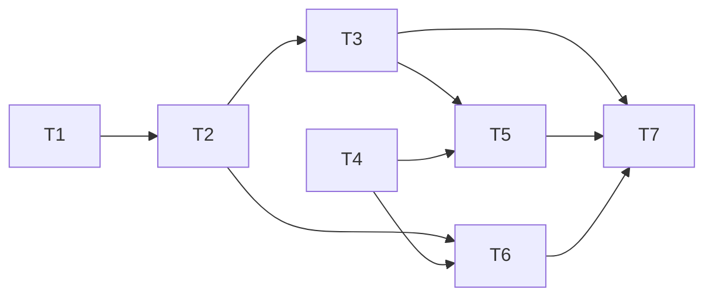

# 21 — Tareas: Portada pública y página "Acerca de"

Los tests de cada tarea los escribe `test-writer` antes de implementar (fase de tests en rojo); cada
tarea se da por hecha cuando sus tests pasan y no quedan tests previos en rojo. Comando de test:
`pnpm test` (Vitest vía `ng test`). Los nombres de test llevan el id del criterio que prueban
(`REQ-n.m`, `NFR-n`), también los de las listas que repiten criterios. Todas las tareas son
obligatorias.

## Mapa de dependencias

T1 y T4 son independientes entre sí y pueden hacerse en paralelo.

## Tareas

- [x] **T1 — Contenido tipado de la página**
  - Archivos nuevos: `src/app/features/about/models/about-content.ts` (`ABOUT_CONTENT`, `RoleActionId`,
    `RoleCard`, `AreaCard`, `OrderStep`, `AboutContent`) y `about-content.spec.ts`.
  - Antes de fijar los textos, confirmar contra el código cada afirmación de pasos y áreas
    (comentario obligatorio al cerrar, legajo, "cerradas hoy", estado y prioridad); acotar el texto
    si alguna no se sostiene.
  - _Requisitos: REQ-3.2, REQ-3.3, REQ-4.1, REQ-4.2, REQ-4.3, REQ-4.4, REQ-4.5, REQ-4.6, REQ-5.1,
    REQ-5.2, NFR-4, NFR-5_
  - Depende de: nada.
  - Se verifica con: `about-content.spec.ts`:
    - `REQ-3.2`: `heroTagline` contiene "órdenes de mantenimiento".
    - `REQ-3.3`: cinco pasos en el orden crear, tomar, cerrar, liberar y cancelar.
    - `REQ-4.1`: cuatro tarjetas de rol con los títulos exactos.
    - `REQ-4.2` a `REQ-4.5`: las acciones de cada tarjeta son exactamente las listadas en los requisitos.
    - `REQ-4.6` y `NFR-5`: para cada acción de cada tarjeta, el predicado de
      `work-order.permissions.ts`, `maintenance.permissions.ts` o `machines.permissions.ts` es
      verdadero para un usuario de ese rol (mapeo de `design.md`).
    - `REQ-5.1` y `REQ-5.2`: cuatro áreas con los títulos exactos, cada una con título y descripción
      no vacíos de una o dos oraciones.
    - `NFR-4`: ningún texto contiene "Angular", "API", "JWT", "token", "repositorio" ni "Spring".

- [x] **T2 — Página `AboutPage`**
  - Archivos nuevos: `features/about/pages/about-page/about-page.ts`, `.html`, `.scss` y
    `about-page.spec.ts`. Usa `ABOUT_CONTENT`, las clases `.card*` y botones `<a routerLink class="btn …">`;
    una columna en mobile y grilla de dos columnas desde `$breakpoint-md`.
  - _Requisitos: REQ-1.3, REQ-3.1, REQ-3.2, REQ-3.3, REQ-3.4, REQ-4.1, REQ-4.2, REQ-4.3, REQ-4.4,
    REQ-4.5, REQ-5.1, REQ-5.2, REQ-6.1, REQ-6.2, REQ-6.3, REQ-6.5, REQ-6.6, NFR-1_
  - Depende de: T1.
  - Se verifica con: `about-page.spec.ts`:
    - `REQ-1.3`: no hay peticiones HTTP (`httpMock.verify()` sin pendientes al renderizar).
    - `REQ-3.1`: un solo `h1` con "Centro de Gestión de Mantenimiento".
    - `REQ-3.2`: la frase bajo el `h1` contiene "órdenes de mantenimiento".
    - `REQ-3.3`: una lista ordenada con los cinco pasos.
    - `REQ-3.4`: no hay `img`, `svg` ni `picture`.
    - `REQ-4.1`, `REQ-5.1`, `REQ-5.2`: cuatro tarjetas de rol y cuatro de área con título y descripción.
    - `REQ-4.2` a `REQ-4.5`: en el DOM, la lista de cada tarjeta de rol muestra exactamente las
      acciones de los requisitos (una plantilla que omita la lista falla).
    - `REQ-6.1` y `REQ-6.2`: sin sesión, dos enlaces "Iniciar sesión" (junto al `h1` y al final).
    - `REQ-6.3`: ambos apuntan a `/login` sin `returnUrl`.
    - `REQ-6.5` y `REQ-6.6`: con sesión, "Ir al tablero" reemplaza a "Iniciar sesión" y apunta a `/dashboard`.
    - `NFR-1`: jerarquía `h1` → `h2` → `h3` sin saltos; `pnpm lint` en verde.

- [x] **T3 — Rutas `/` y `/acerca-de`**
  - Archivo: `src/app/app.routes.ts` (reemplaza `'' → redirectTo 'dashboard'` por las dos rutas
    con `loadComponent`, `title` compartido como constante local y `guestGuard` solo en `''`);
    actualiza y amplía `app.routes.spec.ts`.
  - _Requisitos: REQ-1.1, REQ-1.2, REQ-2.1, REQ-2.2, REQ-6.4, REQ-7.1, REQ-7.2, REQ-9.1, REQ-9.2,
    REQ-9.3, REQ-10.1, NFR-3_
  - Depende de: T2.
  - Se verifica con: `app.routes.spec.ts`:
    - `REQ-1.1` y `REQ-1.2`: sin sesión, `/` renderiza `AboutPage` y la URL sigue siendo `/`; el
      botón "Volver al inicio" del 404 lleva a la portada.
    - `REQ-2.1`: con sesión, `/` termina en `/dashboard`; `/?returnUrl=/work-orders` termina en
      `/work-orders`; un `returnUrl` externo termina en `/dashboard`.
    - `REQ-2.2`: sin sesión, `/dashboard` va a `/login?returnUrl=%2Fdashboard`.
    - `REQ-6.4`: iniciar sesión llegando desde la portada termina en `/dashboard`.
    - `REQ-7.1` y `REQ-7.2`: `/acerca-de` muestra la página con y sin sesión, sin redirigir.
    - `REQ-9.1` a `REQ-9.3`: `/work-orders`, `/maintenance` y `/machines` sin sesión van a login con
      `returnUrl`; con sesión `/login` redirige; una URL inexistente muestra el 404.
    - `REQ-10.1`: el título es `Acerca de | Angular Enterprise Lab` en `/` y en `/acerca-de`.
    - `NFR-3` se comprueba en T7 con `pnpm build` (chunk lazy separado).

- [x] **T4 — Enlace "Acerca de" en el header**
  - Archivos: `layout/header/header.ts` (suma `RouterLink` y `RouterLinkActive`), `header.html`
    (enlace con `ariaCurrentWhenActive="page"`), `styles/layout/_shell.scss` (`.header__link` y
    `.header__user` más angosto por debajo de `md`) y `header.spec.ts` (con `provideRouter([])`).
  - _Requisitos: REQ-8.1, REQ-8.2, REQ-8.3_
  - Depende de: nada.
  - Se verifica con: `header.spec.ts`:
    - `REQ-8.1`: sin sesión el enlace "Acerca de" está presente y apunta a `/acerca-de`; también con
      el router en `/login` y en una URL inexistente (404). Además, en `app.routes.spec.ts`, el
      enlace aparece en el shell real sin sesión en `/login` y en el 404.
    - `REQ-8.2`: con sesión el enlace está junto al nombre del usuario y al botón "Cerrar sesión".
    - `REQ-8.3`: activar el enlace navega a `/acerca-de` y la sesión sigue activa.

- [x] **T5 — La navegación y el shell no cambian**
  - Archivos: se amplían `layout/sidebar/sidebar.spec.ts`, `layout/bottom-nav/bottom-nav.spec.ts`,
    `layout/nav-items.spec.ts` y `app.routes.spec.ts` (o `app-shell.spec.ts`). No se modifica
    código de producción.
  - _Requisitos: REQ-7.3, REQ-7.4, REQ-8.4, REQ-9.4_
  - Depende de: T3, T4.
  - Se verifica con:
    - `REQ-7.3`: con sesión y la URL en `/acerca-de`, el sidebar sigue en el DOM.
    - `REQ-7.4`: ídem con la barra inferior.
    - `REQ-8.4`: ni el sidebar ni la barra inferior incluyen "Acerca de".
    - `REQ-9.4`: `nav-items.spec.ts` sigue verificando los mismos ítems por rol que antes.

- [x] **T6 — Verificación manual responsive y de interfaz** — hecha a mano por el usuario el 2026-10-20, sin problemas (no hubo navegador disponible en la sesión de Claude)
  - Sin cambios de código previstos; si algo falla, se corrige en los archivos de T2 o T4 antes de
    cerrar. Con `pnpm start` y la API en perfil `dev`, anotar el resultado en `notes.md`.
  - _Requisitos: NFR-2, REQ-8.1, REQ-8.2_
  - Depende de: T2, T4.
  - Se verifica con (manual):
    - A 320 y 360 px: sin scroll horizontal, tarjetas en una columna, header legible con y sin
      sesión (el nombre de usuario se trunca, el botón "Cerrar sesión" no sale de pantalla).
    - A 768 px y más: tarjetas en dos o más columnas; sidebar visible con sesión.
    - Navegación por teclado: el enlace "Acerca de" y los botones reciben foco visible.

- [x] **T7 — Cierre de calidad y documentación** (la parte de documentación es cierre de proceso, sin requisito)
  - Corre `pnpm lint`, `pnpm exec ng test --no-watch` y `pnpm build`; confirma que el chunk de la
    página es lazy. Actualiza `.claude/specs/ROADMAP.md` (fila de la spec 21), `CLAUDE.md` ("Specs 00
    a 21" y la siguiente libre, `22`), la tabla de specs del README y `.claude/steering/product.md`
    si cambia la lista de features.
  - _Requisitos: NFR-1, NFR-3, NFR-6_
  - Depende de: T3, T5, T6.
  - Se verifica con:
    - `NFR-1`: `pnpm lint` sin errores.
    - `NFR-3`: la salida de `pnpm build` muestra un chunk lazy propio para `about-page`.
    - `NFR-6`: `ng test` y `pnpm build` en verde.
    - Documentación (cierre de proceso): `ROADMAP.md` tiene la fila 21, `CLAUDE.md` dice "Specs 00 a
      21" y "la siguiente libre es la `22`", y el README lista la spec 21 (verificado con `grep`).

---

**Estado:** Aprobado. T1–T7 hechas; T6 verificada a mano por el usuario.
