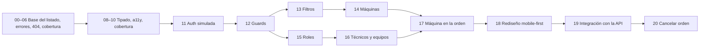

# Roadmap de specs — angular-enterprise-lab

**Estado:** las specs 00 a 20 están implementadas. Quedan pendientes dos tareas sueltas
(ver §3). La numeración se unificó el 2026-10-20 al formato de la API (`00`–`NN`, dos
dígitos, sin letras ni huecos).

Cada spec vive en `.claude/specs/<NN>-<nombre>/`. Las specs 00 a 17 usan el formato
corto (`spec.md` + `plan.md` + `notes.md`); desde la 18 se usa el flujo completo de
`sdd-flow` (`requirements.md` → `design.md` → `tasks.md`). El contexto del proyecto está
en `../steering/`. El mapa de la API es `../../../angular-enterprise-lab-api/.claude/specs/ROADMAP.md`.

## 1. Specs

| #   | Spec                                                 | Feature                        | Formato  | Estado                                                        |
| --- | ---------------------------------------------------- | ------------------------------ | -------- | ------------------------------------------------------------- |
| 00  | Unificar búsqueda, paginación y recarga              | `work-orders`                  | corto    | Hecha                                                         |
| 01  | Recuperación de la búsqueda tras errores             | `work-orders`                  | corto    | Hecha                                                         |
| 02  | Estados de error en detalle y edición                | `work-orders`                  | corto    | Hecha                                                         |
| 03  | Protección de formularios y envíos duplicados        | `work-orders`                  | corto    | Hecha                                                         |
| 04  | Foco y limpieza del modal                            | `shared`                       | corto    | Hecha                                                         |
| 05  | Página 404 y validación de id en rutas               | `work-orders`, rutas           | corto    | Hecha                                                         |
| 06  | Cobertura de tests y verificaciones de formato       | transversal                    | corto    | Hecha                                                         |
| 07  | Auditoría de tipado, accesibilidad y responsive      | transversal                    | corto    | Dividida en 08 y 09                                           |
| 08  | Tipado estricto y aliases                            | transversal                    | corto    | Hecha                                                         |
| 09  | Accesibilidad y responsive                           | transversal                    | corto    | Hecha                                                         |
| 10  | Cobertura de Functions por feature                   | transversal                    | corto    | Hecha                                                         |
| 11  | Autenticación simulada, sesión y logout              | `auth`, `core/auth`            | corto    | Hecha (luego reemplazada por JWT real en la 19)               |
| 12  | Guards de ruta y permisos por rol                    | `core/auth`                    | corto    | Hecha                                                         |
| 13  | Filtros por estado y prioridad                       | `work-orders`                  | corto    | Hecha                                                         |
| 14  | Maestro de máquinas y árbol de partes                | `machines`                     | corto    | Hecha                                                         |
| 15  | Roles extendidos del dominio                         | `auth`, `work-orders`          | corto    | Hecha                                                         |
| 16  | Gestión de técnicos y equipos                        | `maintenance`                  | corto    | Hecha                                                         |
| 17  | Máquina y parte en la orden; tomar, cerrar y liberar | `work-orders`                  | corto    | Hecha                                                         |
| 18  | Rediseño "Tablero de turno", mobile-first            | `dashboard`, `layout`, estilos | completo | Hecha; opcional O2 (skeleton de carga) sin hacer              |
| 19  | Integración con la API real (Spring Boot + JWT)      | `core`, todas                  | completo | Hecha; T12 (opcional, nota sobre filtro por cierre) sin hacer |
| 20  | Cancelar orden (administrador y team leader)         | `work-orders`                  | completo | Hecha                                                         |

## 2. Correspondencia con la API

| Front                                                 | Depende de (API)                           |
| ----------------------------------------------------- | ------------------------------------------ |
| 11, 12, 15 (sesión y roles), 19                       | 00 y enmienda 00-A (login JWT, `/auth/me`) |
| 16 (técnicos y equipos)                               | 01                                         |
| 14 (máquinas y partes)                                | 02                                         |
| 13, 17 (órdenes: listado, alta, tomar/cerrar/liberar) | 03 y 04                                    |
| 18 (dashboard "Turno de hoy") y 19 (resumen)          | 05                                         |
| 20 (cancelar)                                         | enmienda 04-A de la API                    |

## 3. Pendientes

- **19 · T12 (opcional):** dejar en `notes.md` el pedido a la API de `closedFrom`/`closedTo`
  en `GET /work-orders`, para simplificar el cálculo de "cerradas hoy".
- **18 · O2:** skeleton de carga en el dashboard; solo si el estado de carga se siente
  brusco en la verificación manual.
- No hay specs 21+ definidas. Una spec nueva toma el siguiente número libre (`21`).

## 4. Equivalencia con la numeración anterior

Los commits, las ramas y los mensajes de PR conservan la numeración vieja.

| Antes  | Ahora | Antes  | Ahora |
| ------ | ----- | ------ | ----- |
| `001`  | `00`  | `010`  | `11`  |
| `002`  | `01`  | `011`  | `12`  |
| `003`  | `02`  | `012`  | `13`  |
| `004`  | `03`  | `013a` | `14`  |
| `005`  | `04`  | `013b` | `15`  |
| `006`  | `05`  | `013c` | `16`  |
| `007`  | `06`  | `013d` | `17`  |
| `008`  | `07`  | `014`  | `18`  |
| `008a` | `08`  | `018`  | `19`  |
| `008b` | `09`  | `019`  | `20`  |
| `009`  | `10`  |        |       |

Los números `015`–`017` de la serie vieja nunca se usaron. Las menciones a `013` sin letra
(el plan original `013-gestion-equipos-tecnicos`) y a `015-rendimiento-documentacion-despliegue`
en las specs viejas son nombres de planes que nunca existieron como carpeta.
